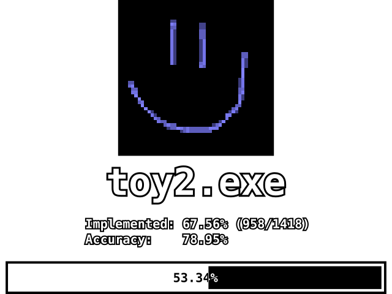

  

## Build setup

Use Visual C++ 6.0 Professional or Enterprise with Service Pack 3, plus DirectX 6.1 Foundations and its bundled DirectX Media 6.0 SDK.

Searchable media identifiers:

- **Microsoft Visual Studio 6.0 Service Pack 3**: disc part number `X04-73525`, CD set `X04-73542-M`.
- **Microsoft DirectX 6.1 SDK**, available in either distribution:
  - **Gold release**.
  - **MSDN Disc 7, April 1999**, part number `X04-61941`.

Place the SDK files in these locations before building:

| SDK files | Repository location |
| --- | --- |
| DX6.1 Foundations headers (`DXF/INCLUDE`) | `external/include/directx6/` |
| DX6.1 `ddraw.lib`, `dxguid.lib`, `dinput.lib`, `dsound.lib` (`DXF/LIB`) | `external/libs/directx6/` |
| Media 6.0 `AMSTREAM.H`, `DDSTREAM.H`, `MMSTREAM.H` (`DXMEDIA/DXMEDIA/INCLUDE`) | `external/include/directx6/media/` |
| Media 6.0 `amstrmid.lib` (`DXMEDIA/DXMEDIA/LIB/X86`) | `external/libs/directx6/amstrmid.lib` |

CMake links the SDK libraries by explicit filename. Use the filename casing shown above on case-sensitive filesystems. Keep the selected VC6 installation's standard headers and libraries on `INCLUDE` and `LIB`; `/ML` selects its single-threaded `LIBC.LIB`, and Debug uses `/MLd` with `LIBCD.LIB`.

`RelWithDebInfo` is the default build type: 32-bit x86, `/O2 /ML /Zi`, and `/DEBUG /INCREMENTAL:NO /FIXED:NO`. The EXE and PDB support instruction comparison with reccmp. `build.py` takes `VS6_BIN_PATH` pointing to the compiler's `VC98/Bin` directory.
